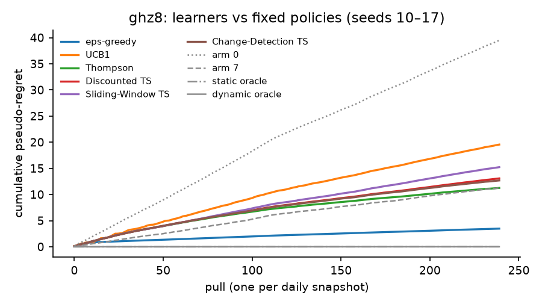
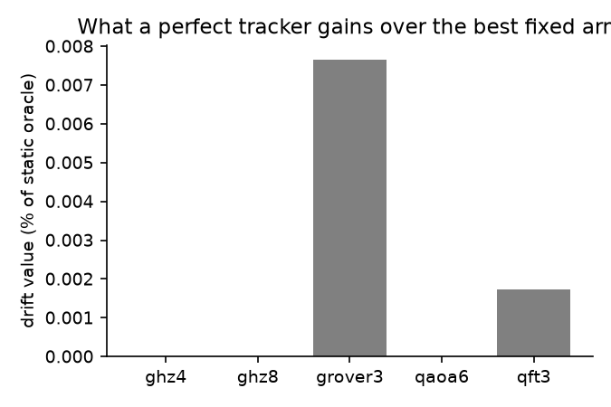
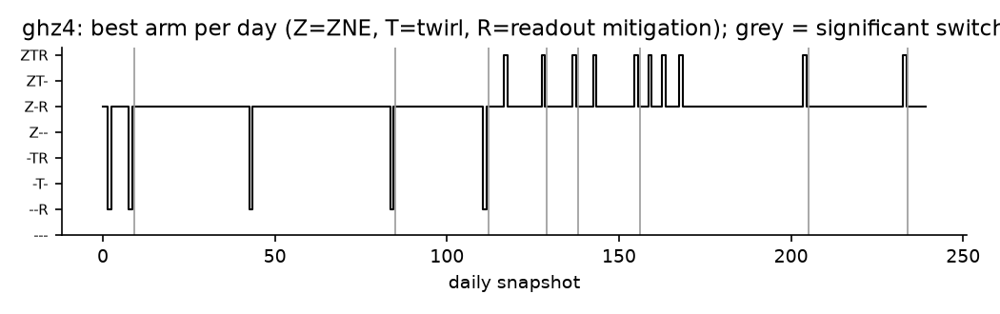
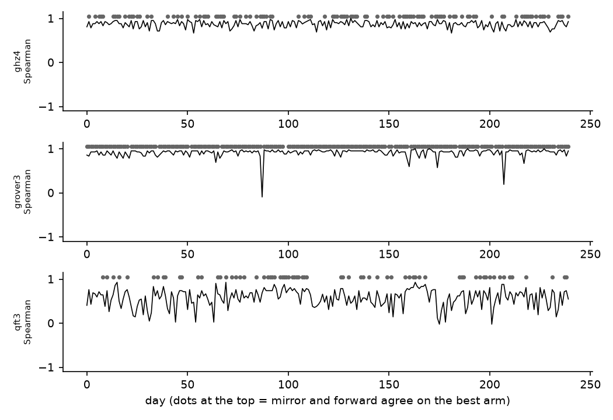

# AutoMitigate

A bandit that chooses which error-mitigation settings to use on a quantum computer, per circuit and per machine, and learns that choice from a mirror-circuit score that needs no ideal answer.

Qollab + IonQ Global Quantum Hackathon, 9 to 11 October 2026. MIT License. This effort is supported by Qollab & IonQ.

Demo video: *(link added before submission)* · Qollab project: *(link added at publish)* · Pre-registered analysis plan: [docs/analysis_plan.md](docs/analysis_plan.md)



## Why we built it

A quantum computer today returns a slightly wrong answer, and there are three standard tricks for cleaning it up. You can run the circuit at deliberately higher noise and extrapolate back to zero (zero-noise extrapolation, ZNE), you can wrap every two-qubit gate in random Pauli flips so that coherent errors average out (Pauli twirling), or you can measure how biased the readout is and subtract that bias (readout-error mitigation, REM). None of them is free and none of them always helps. Each costs extra circuits, each suits some circuits and not others, and the error rates they are fighting move every day and reset at every recalibration. The right combination therefore depends on the circuit, on the machine, and on when you run, and nobody re-checks that by hand.

We treat the choice as a multi-armed bandit, the same mathematics as A/B testing. There are eight arms, one for each way of switching the three tricks on or off. The learner pulls an arm, scores it, updates its estimate, and pulls again. The score comes from a randomised mirror circuit. The circuit is run, scrambled with a random layer of Paulis, and then run backwards with the frame corrected, so the correct output is a single bitstring that is known in advance. The score is simply how often that bitstring comes out. Because no ideal simulation is needed, the method works on circuits whose answer nobody knows.

The tool raised a question we could actually answer with data. If the hardware drifts, does the best mitigation setting drift with it? We wrote down how we would decide that before any reward had been computed, replayed eight months of real IBM calibration history through a noise model, and let the learners run.

## What we found

Over 240 daily calibration snapshots of ibm_fez (1 February to 9 October 2026; the first observed day, 31 January, lacks gate lengths and is skipped), five circuits, eight arms and twenty seeds, ZNE with readout mitigation (arm 5) was the best fixed setting on every circuit, and the per-day best arm left it on only three of the 1200 circuit-days (two days on grover3, one on qft3, each time to arm 7). The drift value, which is how much a tracker that knew the right arm every day would gain over picking once, is at most 0.01 % of the fixed arm's total score. Picking once is as good as tracking.

| circuit | drift value (% of static oracle) | significant best-arm switches | ambiguous-day fraction | static oracle | ε-greedy regret [95 % CI] | everything on (arm 7) | ε-greedy is lower by |
|---|---|---|---|---|---|---|---|
| ghz4 | 0.00 | 0 | 0.17 | ZNE + REM | 1.60 [0.99, 2.74] | 4.46 | 64 % |
| ghz8 | 0.00 | 0 | 0.03 | ZNE + REM | 3.26 [2.01, 6.85] | 11.47 | 72 % |
| grover3 | 0.01 | 2 (3 epochs, median 88 days) | 0.02 | ZNE + REM | 3.08 [1.98, 4.20] | 14.87 | 79 % |
| qaoa6 | 0.00 | 0 | 0.00 | ZNE + REM | 3.19 [2.16, 4.34] | 13.73 | 77 % |
| qft3 | 0.00 | 1 (2 epochs, median 120 days) | 0.34 | ZNE + REM | 2.16 [1.19, 5.08] | 3.96 | 45 % |

A significant switch is a day on which the best arm changes by more than twice the standard error over the seeds. Regret is dynamic pseudo-regret against the per-day oracle, one pull per day, replayed 200 times from the stored rewards; hyperparameters were chosen on seeds 0 to 9 and are reported on seeds 10 to 19. The full text that the analysis script regenerates after every seed pass is in [docs/results.md](docs/results.md).



Since there was nothing to track, the bandit's job reduces to finding the right setting cheaply, and the simplest learner did that best. ε-greedy with ε = 0.1 beat the everything-on default by 45 to 79 % in regret on every circuit. The Thompson family (plain, discounted, sliding-window and change-detection) sat between the two on four circuits and matched the default on ghz8, and UCB1 was worst, because with rewards in [0, 1] and arm gaps of a few hundredths both the Bernoulli trick and UCB1's bonus over-explore. On the two circuits with a significant switch, ε-greedy re-locked onto the new best arm within 5 to 12 pulls.



The obvious doubt is whether a mirror score has anything to do with the error on the circuit you actually care about, so we checked that day by day on ghz4, grover3 and qft3, where a forward observable with a known ideal value exists. The mirror score's ranking of the eight arms agrees with the real forward error at a median Spearman correlation of 0.88, 0.93 and 0.62, and the arm it picks costs about 8 % of the worst arm's forward error on qft3, 1 % on ghz4 and 0 % on grover3. Top-1 agreement is lower on ghz4 and qft3 because the top arms there are within noise of each other, which is exactly when the choice does not matter.



The caveat is that this held on a good chain of qubits. On the median-ranked chain the best setting did drift, nine significant switches on ghz4 with a drift value of 0.37 %, so tracking matters where the hardware is worse. The other sensitivities left the headline alone. Exponential instead of linear ZNE keeps the drift value at or below 0.16 % on every circuit, a coherent fraction of 0.3 instead of 0 changes nothing, and the shot budget (600, 1200, 2400) is reported as a Pareto figure only, since every arm spends the same shots.

The same tool was run on an IonQ-like static model (depolarising constants at IonQ's published Aria-1 figures) with a synthetic drift schedule. On ghz4, the circuit the demo shows, the everything-on arm stays best on both sides of the jump, so that replay measures the cost of exploration when there is nothing to find; on qft3 the best arm moves from arm 5 to arm 7 at the jump. The local model agrees with Qollab's Aria-1 simulator to a mean absolute difference of 0.027 in P(target) over eight identical single circuits, with the job IDs in [data/ionq/spot_check.json](data/ionq/spot_check.json).

## How it works

| arm | ZNE | twirl | REM | circuits per pull |
|---|---|---|---|---|
| 0 | | | | 1 |
| 1 | | | x | 1 (+2 calibration) |
| 2 | | x | | 8 |
| 3 | | x | x | 8 (+2) |
| 4 | x | | | 3 |
| 5 | x | | x | 3 (+2) |
| 6 | x | x | | 24 |
| 7 | x | x | x | 24 (+2) |

The reward is the mirror score of Proctor et al. (arXiv 2008.11294): U · Q · Ũ⁻¹ with a random Pauli layer Q and a Pauli-frame-corrected inverse, scored as P(target), averaged over the eight twirl copies, extrapolated 1x/3x/5x to zero noise by a linear fit for ZNE arms (clipped to [0, 1], clips flagged), and corrected by tensored assignment-matrix inversion for REM arms. Every arm spends the same 1200 shots per pull, split 1200 / 400 / 150 / 50 per circuit for the 1, 3, 8 and 24-circuit shapes, so a heavier trick pays in precision and the bandit finds out whether that trade is worth it.

The learners are ε-greedy, UCB1, Thompson sampling with the Bernoulli trick, discounted Thompson sampling (Raj and Kalyani 2017), sliding-window Thompson sampling (Trovò et al. 2020) and a Thompson sampler with the M-UCB change detector (Cao et al. 2019). Every chart also carries four fixed policies, which are nothing on, everything on, the best fixed arm in hindsight, and the per-day oracle.

Rewards come from Qiskit Aer with the density-matrix method. The first source is a per-day noise model rebuilt from the real ibm_fez calibration log, with thermal relaxation from T1, T2 and the reported gate and readout durations, depolarising error sized so that the average gate infidelity matches the reported error, and asymmetric readout error, on one fixed linear chain per circuit size chosen once on the first complete day. The second source is the IonQ-like model above with extra per-cz Pauli rate p, cz over-rotation θ and extra readout flip r on a schedule (stable, slow, jump); settings A = (0.03, 0.05, 0) and B = (0.01, 0.15, 0) are in [data/calib/ab.json](data/calib/ab.json).

The pipeline is `scripts/fetch_calibration.py`, then `scripts/sweep.py` (one row per day, circuit, arm and seed), then `scripts/analysis.py` (headline, learners, best-arm, proxy, drivers, sensitivity, pareto, figures, results-md), then `scripts/export_replay.py` for the tables the Qollab demo replays.

## Running it

On Qollab, open the project and press Run. The form under Run settings chooses the circuit (ghz4, qft3, grover3, ghz8, qaoa6), the source (ibm or ionq), the drift schedule (ionq only) and the learner. The replay uses the committed reward tables in [data/replay/](data/replay/) and finishes in a few seconds with the regret table, a two-panel figure (regret curves, and the arm chosen each day against the per-day best arm) and a recommendation with the Qiskit snippet to apply it. With `live = True`, which is the default, the chosen circuit is then executed for real on the backend you selected, raw and with readout mitigation from two calibration circuits in the same job. Pick an IBM noise-model simulator (QPU, IBM, Fez) to see the noise; in our runs the GHZ-8 parity went from 0.82 raw to 0.94 mitigated against an ideal of 1.00 ([data/ionq/live_runs.json](data/ionq/live_runs.json)). IonQ backends accept one circuit per run, so there only the raw run is made and the console says so. ZNE and the mirror reward cannot be executed through Qollab's compiler, which cancels folded and mirrored structure (see Limitations), so the full arm is scored offline in the replay tables.

Locally:

```bash
git clone https://github.com/I-ala-Wilson/automitigate && cd automitigate
python3.12 -m venv .venv && source .venv/bin/activate   # Windows: py -3.12 -m venv .venv && .venv\Scripts\activate
python -m pip install --upgrade pip
pip install -e ".[sweep,dev]"
pytest -q                                                # 39 tests, about 15 s
python -c "import main; main.main(circuit='ghz8', live=False)"   # the replay the Qollab demo runs
```

On your own circuit and backend, `automitigate.arms.transpile_once` followed by `apply_arm(qc_t, ARMS[a], twin_rng_seed)` gives the circuits for arm `a` and the target bitstring, `automitigate.score.score_pull` turns their counts into the reward, and any learner in `automitigate.learners` exposes `select()` and `update(arm, reward)`. `scripts/sweep.py` is that loop over a noise model and `main.py` is the same loop over stored rewards.

## Reproducing the tables

```bash
python scripts/fetch_calibration.py                       # HF phanerozoic/qiskit-calibration-drift, revision pinned in automitigate/noise_model.py
python scripts/sweep.py --source ibm --circuits ghz4,qft3,grover3,ghz8,qaoa6 --seeds 0-19 --out data/ibm/ian_seed0.jsonl.gz   # the committed study is 40 such shards, one per seed and laptop
python scripts/sweep.py --source ibm --circuits ghz4,qft3,grover3 --seeds 0-4 --forward --out data/ibm/forward.jsonl.gz
python scripts/sweep.py --source ibm --circuits ghz4,qft3 --seeds 0-9 --f 0.3 --out data/ibm/f03.jsonl.gz
python scripts/sweep.py --source ibm --circuits ghz4 --seeds 0-4 --chain-rank median --out data/ibm/median.jsonl.gz
python scripts/sweep.py --source ionq_like --circuits ghz4,qft3,grover3 --seeds 0-4 --out data/ionq_like/table.jsonl.gz
python scripts/analysis.py all --final && python scripts/export_replay.py
```

`python scripts/run_queue.py --laptop ian --dry-run` prints the exact stage order the two laptops ran. One (day, circuit, eight arms, one seed) cell costs 0.3 s for ghz4, 0.5 s for qft3, 1.4 s for ghz8, 1.5 s for grover3 and 3.2 s for qaoa6 on a 2024 MacBook Pro, so the twenty-seed study is roughly ten laptop-hours. Every result number in this README is in [data/analysis/](data/analysis/) as JSON, and `requirements.lock` pins the exact package versions the study ran with.

## Limitations

These are written out in full in [docs/analysis_plan.md](docs/analysis_plan.md), which was committed before the first drift reward existed. Its definitions have not changed since; the dated notes at its end record findings, including threat 10 below, which was added after the pre-registered nine.

1. Everything is simulation. Each reward comes from Aer with a noise model rebuilt from calibration data; the device itself was never run.
2. The noise model is Markovian and local, with no crosstalk, leakage or time-correlated noise within a day.
3. The coherent fraction of the two-qubit error is assumed (0 primary, 0.3 sensitivity). Under coherent error the mirror construction partially echoes the over-rotation and flatters the non-twirled arms.
4. One device, and one chain per circuit size; the median-chain sensitivity shows how much that choice matters.
5. The mirror proxy is not the user's observable; the per-day proxy validation quantifies the gap.
6. The drift on the IonQ-like source is synthetic.
7. Qollab's IonQ simulator is itself a model of the device.
8. Daily snapshots with last value carried forward do not resolve sub-daily recalibrations.
9. The dynamic oracle uses seed-mean rewards, which no learner can attain.
10. Qollab's compiler cancels mirror and folded structure on every backend we tested. Identity chains of up to 40 gates return P ≈ 1 even with barriers, and on the Aria-1 noise-model simulator a non-cancellable 4-qubit Clifford ladder of 36 CX gates returns exactly P = 1 ([data/e0_runs.jsonl](data/e0_runs.jsonl), job IDs inside). Neither ZNE, nor mirror scoring, nor a two-qubit error fit can therefore be run through Qollab, the IonQ-like constants stay at published figures, and the spot check is informative only where injected errors survive compilation.

## Extending it

An arm is a dict in `ARMS` in `automitigate/arms.py` plus the matching branch in `apply_arm`; `shots_per_circuit` keeps the budget equal. A learner subclasses `Learner` in `automitigate/learners.py` with `select`, `update` and `reset`, and is registered in `LEARNERS` so the demo form picks it up by name. A circuit is a function returning a `QuantumCircuit` without measurements in `automitigate/circuits.py`, registered in `CIRCUITS`, with its forward observable added to `automitigate/forward.py` if you want the proxy validation. A backend is anything with `.run(circuits, shots=...)` that returns Qiskit-style counts.

## Data and disclosure

The drift study uses the IBM calibration time series `phanerozoic/qiskit-calibration-drift` (ibm_fez, 31 January to 9 October 2026, 241 observed days, CC-BY-4.0, revision 56f55fb8 pinned in `automitigate/noise_model.py`; its CC-BY-NC `SN` column is never loaded), replayed through Aer noise models rebuilt per day. The sweeps ran on two laptops. The IonQ-like table uses depolarising constants at published Aria-1 figures (p1 = 5·10⁻⁴, p2 = 6·10⁻³, readout 4·10⁻³); the planned fit of those constants from Qollab's Aria-1 simulator could not be completed for the reason given in limitation 10, and the readout runs there give a per-qubit flip of about 6·10⁻⁴ for |1⟩ and 0 for |0⟩. Qollab's IonQ simulators are noise-model simulators run by Qollab, and IonQ gives no accuracy guarantee for them.

The project was built in the hackathon window. The plan and the empty repository skeleton (packaging, CI, README template) were prepared before the window and are the only pre-window material. AI coding assistants were used during development. Libraries: Qiskit, Qiskit Aer, NumPy, SciPy, pandas, Matplotlib, scikit-learn.

## Related work

One line per paper in [docs/related_work.md](docs/related_work.md). CMAB-ZNE (arXiv 2608.06426) is a contextual bandit over ZNE fold sets only, GSC-QEMit (2604.24551) uses simulator knobs as arms, QBalance (2605.02966) orders compilation and mitigation strategies with Thompson sampling but evaluates no drift, and APGEM (2610.01253) needs the ideal expectation value for its reward. None evaluates non-stationary learners on real calibration history. The mirror-circuit reward follows Proctor et al. (2008.11294, 2112.09853) and the learners follow Agrawal and Goyal 2012, Raj and Kalyani 2017, Trovò et al. 2020 and Cao et al. 2019. arXiv 2507.01195 reports raw fidelity as stationary within calibration cycles and 2609.38713 reports ZNE hurting on most runs; this replay speaks to the question between them, which is whether the best mitigation setting moves rather than the raw fidelity. On a good chain it does not. On a worse chain it does.

## Authors

Ian Wilson and Thomas Sebahi, McGill University.
